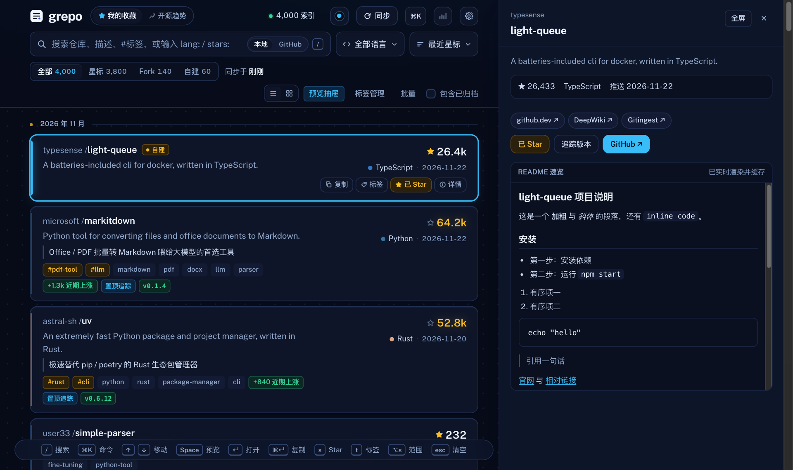
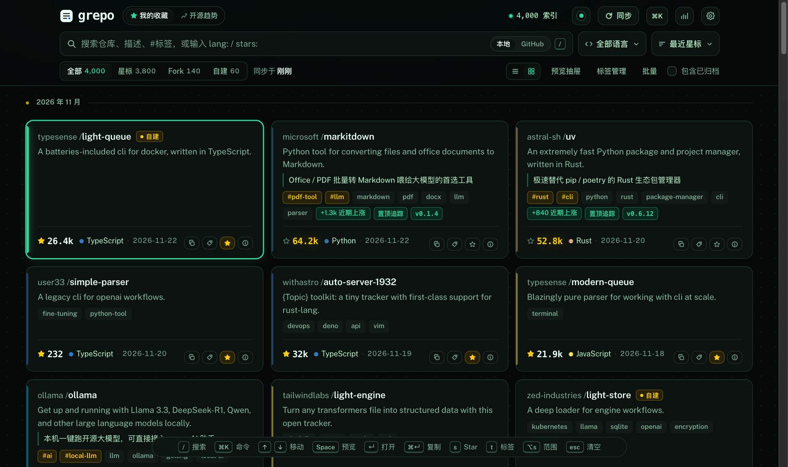
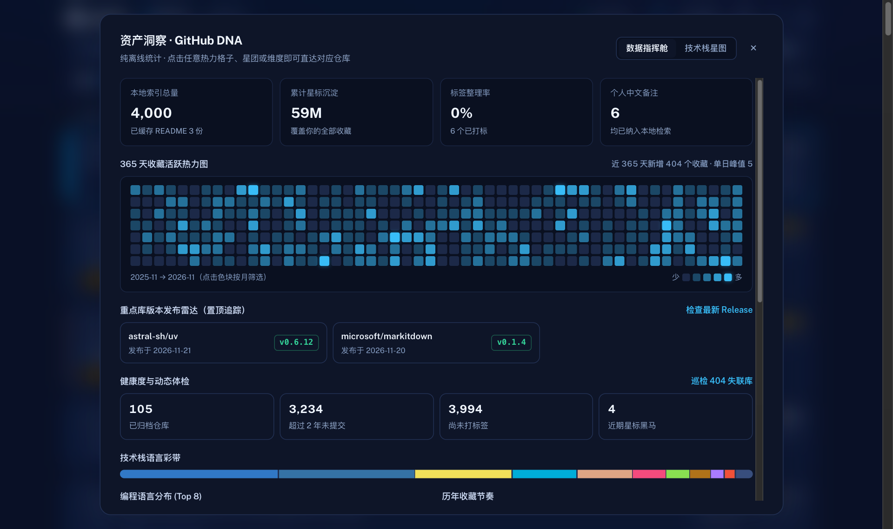
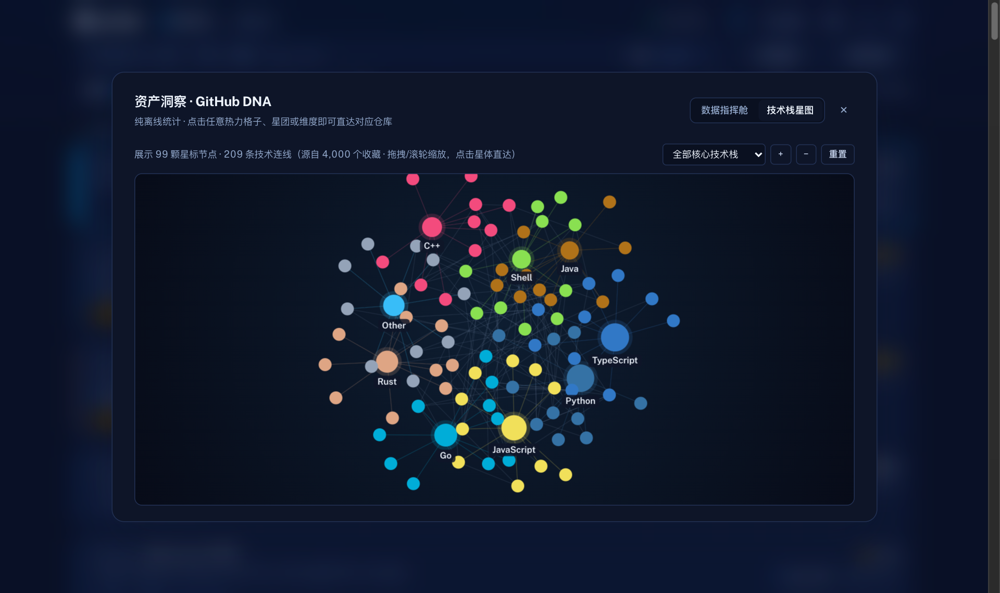
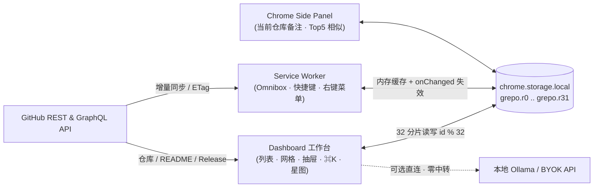

<div align="center">


# grepo

**把几千个 GitHub Star 变成毫秒级本地检索的知识指挥舱**

[](extension/manifest.json)
[](extension/manifest.json)
[](scripts/validate-themes.mjs)
[](#隐私与权限说明)
[](LICENSE)

[界面预览](#界面预览) · [核心特性](#核心特性) · [搜索语法 DSL](#高级搜索语法-dsl) · [快速安装](#快速安装) · [键盘快捷键](#键盘快捷键) · [架构与性能](#架构与性能设计) · [开发与打包](#开发测试与打包)

</div>

---

## 为什么做 grepo？

当你收藏了 **2,000～10,000+ 个 GitHub 仓库** 之后，GitHub 原生的 Stars 页面很快就会失效：

- **想不起来名字**：只记得“那个 Rust 写的极速 Python 包管理器”或“把 PDF 转 Markdown 喂给大模型的库”，关键词一歪就搜不到；
- **收藏即吃灰**：没有个人中文备注，三个月后点开都忘了当初为什么 Star；
- **浏览效率低**：想横向翻看 5 个同类工具，必须在十几个标签页之间反复跳转；
- **缺乏全局视角**：不知道自己的技术栈分布、哪些旧库已经删库 404、主力依赖最近发了什么大版本。

**grepo** 是一款零后端、纯本地运行的 Chrome Manifest V3 扩展（另附独立 Python CLI）：它将你的 Star、Fork 与自建仓库按 **32 分片增量索引** 在本机浏览器中，提供 **< 6ms 级过滤检索**、联动预览抽屉、`⌘K` 命令面板、浏览器侧边栏上下文助手、GitHub Star Lists 双向同步、技术栈交互星图，以及可选的本地 Ollama / BYOK AI 整理能力。

---

## 界面预览

### 极光深蓝（Aurora）主工作台 + 右侧联动预览抽屉

> `Space` / `p` 一键呼出右侧联动抽屉，用 `↑/↓` 或 `j/k` 连续切库即可毫秒级预览中文备注、快捷外链、最新 Release 与 README。



### 终端赛博（Cyber）+ Bento 多列卡片网格视图

> 列表与 Bento 卡片网格一键切换；每张卡片配备 3px 编程语言色条与 60fps 零重排鼠标聚光灯。



### 资产洞察 · GitHub DNA（365 天热力图 + Release 版本雷达）与离线技术栈星图

<table>
  <tr>
    <td width="50%">
      
      <p align="center"><sub>365 天收藏活跃热力图、重点库版本雷达、健康度体检与多色语言彩带</sub></p>
    </td>
    <td width="50%">
      
      <p align="center"><sub>纯前端 Canvas 2D 离线技术栈星图（拖拽、缩放、悬停高亮连通子图、点击直达）</sub></p>
    </td>
  </tr>
</table>

---

## 核心特性

### 1. 毫秒级本地检索与高级 DSL
- **32 分片增量引擎**：仓库按 `id % 32` 写入分片，增量同步只重写变更分片；4,000+ 仓库复合过滤耗时 **< 6ms**。
- **强大检索能力**：支持高级 DSL、`OR` 联合查询、`-` 否定排除、**1 字符 Damerau-Levenshtein 拼写容错**（如 `loadre` → `loader`）、已缓存 README 离线全文降级检索。
- **所见即所得交互**：输入语法前缀实时弹出自动补全，生效条件在搜索栏下方渲染为**彩色可点击移除的筛选胶囊**；空搜索框聚焦展示最近 8 条搜索历史。
- **本地 ↔ 全站无缝切换**：`⌥S` / `Tab` 一键切换至 GitHub 全站搜索，支持 **1-Click 乐观 Star**、金星微粒子动效与 `⌘Z` 即时撤销；同步内置「开源趋势（今日 / 本周 / 本月）」热榜。

### 2. 极客效率工作流
- **右侧联动预览抽屉（QuickLook Split Drawer）**：`Space` / `p` 开关，宽屏自动左移列表与底部快捷键栏（零遮挡），`↑/↓` 连续阅览并带 240ms API 防抖。
- **全局 `⌘K` / `Ctrl+K` 命令面板**：任意焦点直达全部操作、8 套主题、已保存视图、高频标签、最近查看与仓库跳转。
- **双布局 + 双密度**：支持 **列表 / Bento 多列网格** 切换与 **舒适 / 紧凑** 列表密度切换。
- **批量整理模式**：浮岛式多选工具栏，支持全选当前、批量追加 `#标签`、批量 AI 整理、2～5 个同类库一键 AI 选型对比与批量取消 Star。

### 3. 知识管理与跨平台同步
- **个人中文备注与高频标签建议**：支持为每个仓库写本地中文备注（纳入毫秒搜索），编辑标签时自动展示已有高频标签点选芯片，避免同义碎片标签。
- **标签管理中心 & GitHub Star Lists 双向同步**：支持重命名、合并与删除本地标签，并可通过 GitHub GraphQL API **双向同步官方 Star Lists**（导入 Lists 为本地 `#标签` / 将本地标签推送建表至 GitHub Lists）。
- **快捷视图与自定义外链**：一键将复杂 DSL 筛选条件存为顶部快捷视图；支持自定义外链模板（默认内置 `github.dev`、`DeepWiki`、`Gitingest`），并在详情页与侧边栏同步 **HTTPS / SSH `git clone`** 协议切换。
- **多格式备份与迁移**：完整 JSON 备份/恢复（保留标签、中文备注、置顶追踪、外链与视图）、按标签自动分节导出 **Awesome Markdown** 与 **CSV** 表格。

### 4. 浏览器级深度集成
- **地址栏 Omnibox 秒搜**：在 Chrome 地址栏输入 `gr <关键词>` 直接按名称/备注/标签/星标加权检索并直达仓库。
- **Chrome Side Panel 侧边栏**：浏览任意 GitHub 仓库页面时，右侧边栏自动识别当前项目，原地编辑标签/中文备注、一键 Star/复制 Clone，并纯离线计算展示 **本地同类相似收藏 Top 5**；任何网页均可使用侧边栏内置的迷你本地速搜。
- **右键菜单与全局快捷键**：页面右键菜单直达侧边栏或工作台，`⌘⇧G` / `⌘⇧E` 全局秒唤。

### 5. 资产洞察 · GitHub DNA、技术栈星图与版本雷达
- **365 天活跃热力矩阵 + 多色语言彩带**：直观呈现收藏节奏与技术栈占比，点击任意日期格子或语言色段直接回列表筛选。
- **交互式技术栈星图（Constellation）**：基于 HTML5 Canvas 2D 离线力导向聚类，将语言、高星仓库与共同 Topic/Tag 编织成可缩放拖拽的星系图，物理收敛后自动停止 `rAF` 渲染循环（0% 闲置 CPU）。
- **重点库 Release 版本雷达**：支持给最多 30 个核心仓库开启「置顶追踪（`is:pinned`）」，拉取最新 Release 版本号与更新日志摘要，在卡片、预览抽屉、详情弹窗及洞察雷达中同步呈现。
- **健康体检、404 失联巡检与每日拾遗**：一键定位已归档、超过 2 年未提交、未打标、近期星标飙升仓库；全量同步自动 Diff 记录失联库，并支持主动在线巡检 404/410/451 删库项目；随机漫步每日捞起尘封好项目。

### 6. Privacy-First 本地 AI 与 README 离线预热
- **隐私优先 AI 助手（完全可选）**：默认不启用，仅直连本机 **Ollama**（如 `http://localhost:11434/v1`）或用户自填的 OpenAI 兼容接口（BYOK），无任何中间代理：
  - 单库 / 批量自动生成中文用途备注与推荐标签；
  - 搜索建议面板底部常驻 **AI 语义找库**（本地粗召回 + 大模型语义重排）；
  - 详情页相似推荐或批量模式一键生成 **同类库选型对比表**。
- **可控速 README 离线预热队列**：在设置中一键后台静默预热前 120 个置顶/已打标/高星仓库的 README（LRU 上限 500 份，260ms 温和节流，自动感知 `X-RateLimit-Remaining` 低配额保护，支持随时暂停）。

---

## 高级搜索语法 DSL

搜索框支持自由组合以下条件，并自动解析为可单点移除的彩色筛选胶囊：

| 语法 | 示例 | 说明 |
|---|---|---|
| `lang:` / `language:` | `lang:rust` / `-lang:java` | 按编程语言精确筛选或排除 |
| `#标签` / `tag:` / `topic:` | `#llm` / `tag:pdf-tool` / `-#deprecated` | 匹配自定义 `#标签` 或仓库 GitHub Topic |
| `stars:` | `stars:>10k` / `stars:<500` | 按星标数区间过滤（支持 `k` / `m` 后缀） |
| `pushed:` / `starred:` | `pushed:>2026-01` / `starred:2025` | 按最近推送时间或收藏年份/月份筛选 |
| `owner:` / `org:` | `owner:astral-sh` | 按仓库作者或组织筛选 |
| `is:` 状态标志 | `is:pinned` `is:rising` `is:stale` `is:archived` `is:fork` `is:owned` | 筛选置顶追踪、近期飙升、2 年未更新、已归档等状态 |
| `has:` / `no:` | `has:note` `has:tag` `no:tag` `no:note` | 快速找出已整理或待整理的收藏 |
| `OR` 联合查询 | `lang:rust OR lang:go` | 多分支并集匹配 |
| `-关键词` | `rag -langchain` | 排除包含指定关键词的仓库 |
| 1 字符拼写容错 | `loadre` / `markitdwon` | 自动容错 1 次相邻颠倒、替换或增删 |

---

## 8 套精密光学主题（全量通过 WCAG AA 校验）

全部 8 套主题（5 套浅色 + 3 套旗舰暗色）均通过 [`scripts/validate-themes.mjs`](scripts/validate-themes.mjs) 全部 13 组语义色对 WCAG AA（≥ 4.5:1）自动校验，且主工作台与 Side Panel 实时同步：

| 主题 | 标识 | 风格定位 | 最低对比度 |
|---|---|---|---|
| **工坊精工**（默认） | `atelier` | 高对比度 Slate & 电光钴蓝 | `4.75:1` |
| **纸面索引** | `paper` | 暖白素纸与经典钴蓝账本 | `4.75:1` |
| **素瓷** | `porcelain` | 冷调白瓷与深靛蓝 | `4.64:1` |
| **素麻** | `linen` | 温润亚麻与松烟墨绿 | `4.84:1` |
| **青瓷** | `celadon` | 淡青瓷底与竹青功能色 | `4.51:1` |
| **墨夜暗色** | `obsidian` | 深邃炭蓝、极光洗色与微点阵网格 | `5.30:1` |
| **极光深蓝** | `aurora` | 午夜靛青极光、冰蓝高光与磨砂玻璃 | `6.26:1` |
| **终端赛博** | `cyber` | 纯碳黑、激光翠绿与等宽数字遥测感 | `6.62:1` |

---

## 快速安装

### 1. 在 Chrome / Edge / Arc / Brave 中加载扩展

```bash
git clone https://github.com/endlessc/grepo.git
```

1. 浏览器地址栏打开 `chrome://extensions`
2. 开启右上角 **开发者模式（Developer mode）**
3. 点击 **加载已解压的扩展程序（Load unpacked）**
4. 选择项目中的 **`extension/`** 目录即可使用（无需任何构建步骤）

### 2. 配置 GitHub Token

首次打开 grepo 后，前往 [github.com/settings/tokens/new](https://github.com/settings/tokens/new) 生成 Personal Access Token：

| 功能场景 | 所需 Scope（Classic PAT） | 说明 |
|---|---|---|
| 同步公开 Star / Fork / 取消 Star | `public_repo` | 基础必备权限 |
| 同步个人私有仓库 | `repo` | 仅需索引私有库时勾选 |
| GitHub Star Lists 双向同步（GraphQL） | `user` | 仅需使用 Lists 导入/推送时勾选 |

---

## 隐私与权限说明

- **零后端、零追踪**：grepo 不包含任何第三方后端或统计脚本；GitHub Token、全部仓库索引、个人中文备注与 README 缓存仅保存在你本机的 `chrome.storage.local` 中。
- **最小化权限**：
  - `storage` / `unlimitedStorage`：本地持久化 32 分片索引与离线 README 缓存；
  - `tabs` / `sidePanel` / `contextMenus`：实现标签页复用、识别当前 GitHub 仓库页与右键菜单呼出侧边栏；
  - `host_permissions`：仅默认授权 `api.github.com` 与 `github.com`；
  - `optional_host_permissions`：仅当你主动配置本地 Ollama 或第三方 AI 接口时，才按需向对应域名申请访问权限。

---

## 键盘快捷键

| 快捷键（macOS） | Windows / Linux | 功能 |
|---|---|---|
| `/` | `/` | 聚焦搜索框 |
| `⌘K` | `Ctrl+K` | 呼出全局命令面板 |
| `Space` / `p` | `Space` / `p` | 开关右侧联动预览抽屉 |
| `↑` / `↓` 或 `j` / `k` | `↑` / `↓` 或 `j` / `k` | 上下切换仓库（抽屉打开时实时联动预览） |
| `Enter` / `o` | `Enter` / `o` | 在新标签页打开选中仓库 |
| `⌘↵` | `Ctrl+↵` | 复制选中仓库链接 |
| `s` | `s` | Star / 取消 Star（`⌘Z` / `Ctrl+Z` 即时撤销） |
| `t` | `t` | 编辑自定义 `#标签` 与个人中文备注 |
| `⌥S` / `Tab` | `Alt+S` / `Tab` | 切换本地收藏 ↔ GitHub 全站搜索 |
| `i` | `i` | 打开资产洞察 · GitHub DNA 看板 |
| `Esc` | `Esc` | 逐级关闭浮层 / 抽屉 / 清空搜索 |
| `⌘⇧G`（全局） | `Alt+Shift+G` | 从任意页面打开或切回 grepo 主工作台 |
| `⌘⇧E`（全局） | `Alt+Shift+S` | 从任意页面呼出 grepo Chrome 侧边栏 |
| 地址栏 `gr <词>` | 地址栏 `gr <词>` | Chrome 地址栏 Omnibox 秒搜本地收藏 |

---

## 架构与性能设计



在 4,000 条真实分布仓库样本下的性能实测（Chrome Headless 自动化压测）：

| 优化维度 | 实现机制 | 实测表现 |
|---|---|---|
| **32 分片增量落盘** | 仓库按 `id % 32` 分片存储，增量同步与改标签仅重写命中分片 | 避免整块 4MB JSON 反复序列化 |
| **复合过滤耗时** | 缓存语言/标签/作者分面索引 + O(L) 编辑距离容错 | 4,000 仓库 `OR + DSL` 过滤 **5.7ms** |
| **长列表滚动隔离** | 80 条/页 `IntersectionObserver` 懒渲染 + `content-visibility: auto` | 离屏卡片跳过布局与绘制 |
| **60fps 鼠标聚光灯** | 全局单委托 `pointermove` + `rAF` 节流 + 单卡 `rect` 缓存（滚动失效） | 60 次连续移动总耗时 **0.6～1.3ms** |
| **0% 闲置能耗** | 静态极光与微点阵背景无常驻动画；Canvas 星图物理收敛后自动停止 `rAF` | 静置页面 **0 CPU / GPU 占用** |

---

## 附带 Python CLI（可选）

如果你也习惯在终端里配合 `fzf` 检索收藏，[`cli/grepo.py`](cli/grepo.py) 提供了零依赖 Python 3 命令行版本（本地 SQLite 索引）：

```bash
python3 cli/grepo.py setup               # 录入 GitHub Token
python3 cli/grepo.py sync                # 同步全部 Star / Fork / 自建仓库
python3 cli/grepo.py                     # fzf 交互模糊浏览
python3 cli/grepo.py -l --lang rust rag  # 命令行管道输出（支持 --json / --stars / --since）
python3 cli/grepo.py tag owner/repo llm  # 打标签与备注
```

---

## 项目结构

```text
grepo/
├── extension/                        # 纯净 Chrome MV3 扩展包（可直接加载或上传商店）
│   ├── manifest.json                 # MV3 清单（v3.0.0）
│   ├── background/
│   │   └── service-worker.js         # Service Worker（Omnibox / 快捷键 / 右键菜单）
│   ├── pages/
│   │   ├── dashboard/                # 主工作台（index.html / app.css / app.js）
│   │   └── sidepanel/                # 侧边栏页（sidepanel.html / sidepanel.css / sidepanel.js）
│   ├── assets/
│   │   ├── icons/                    # 16 / 32 / 48 / 128 扩展图标
│   │   └── fonts/                    # PublicSans.woff2 离线字体
│   └── vendor/
│       └── marked.min.js             # 本地 Markdown 渲染库
├── cli/
│   └── grepo.py                      # 独立 Python CLI 工具
├── docs/
│   ├── screenshots/                  # README 实机界面预览图
│   └── themes/                       # 配色系统设计文档
├── scripts/
│   ├── make-icons.py                 # 生成多尺寸扩展图标
│   ├── validate-themes.mjs           # 8 套主题 WCAG AA 对比度校验
│   └── pack-extension.sh             # 一键打包 dist/grepo-chrome-v3.0.0.zip
├── tests/                            # 自动化 E2E 验收与性能压测套件
├── LICENSE                           # MIT License
├── package.json
└── README.md
```

---

## 开发、测试与打包

环境要求：Node.js 18+（运行自动化测试需要本机安装 Google Chrome）。

```bash
# 1. 静态全量校验：manifest 入口资源、JS 语法、HTML/JS DOM ID 映射、8 套主题 WCAG AA 对比度
npm run validate

# 2. 生成 4,000 条本地测试样本（仅首次运行）
npm run test:fixture

# 3. 运行无头 Chrome 自动化回归测试
npm run test:smoke    # 4,000 仓库首次同步、检索、筛选、排序、翻页与 32 分片持久化
npm run test:search   # 搜索建议面板、名称命中优先、GitHub 全站检索、Star/撤销与趋势复位
npm run test:ux       # P0 体验、详情补齐、标签弹窗、主题持久化与 README 安全渲染

# 4. 打包可直接上传 Chrome Web Store 的发布包（输出至 dist/grepo-chrome-v3.0.0.zip）
npm run pack
```

---

## License

本项目基于 [MIT License](LICENSE) 开源。
